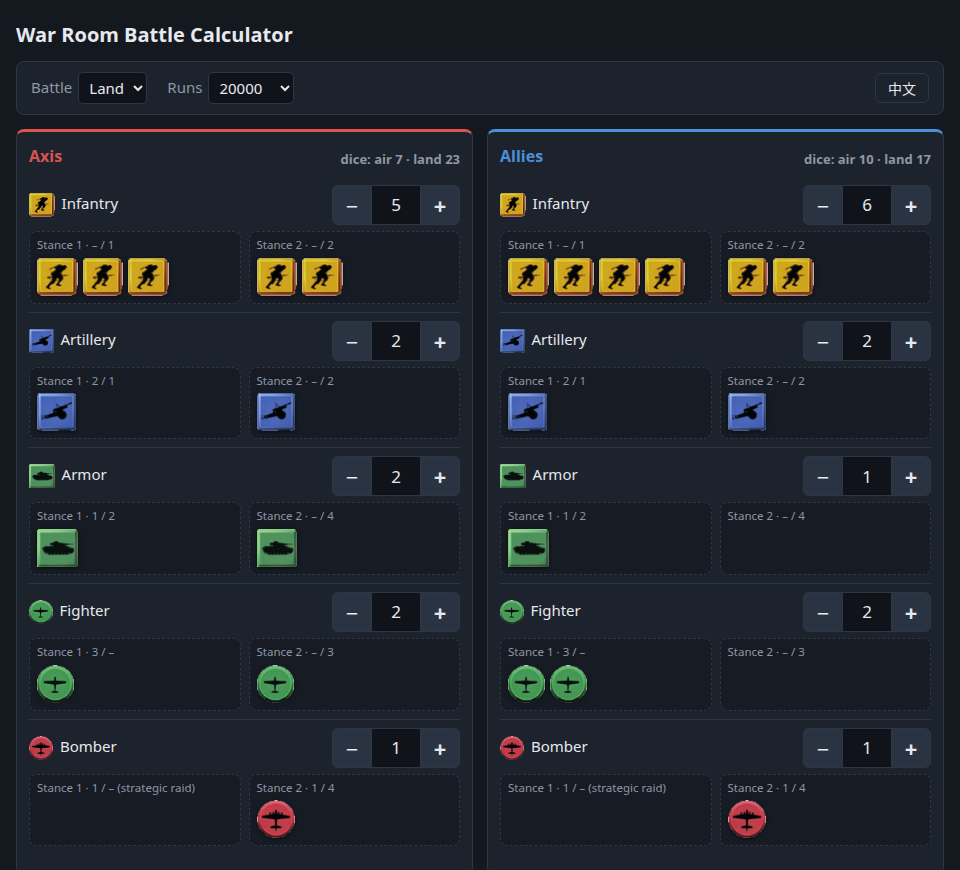
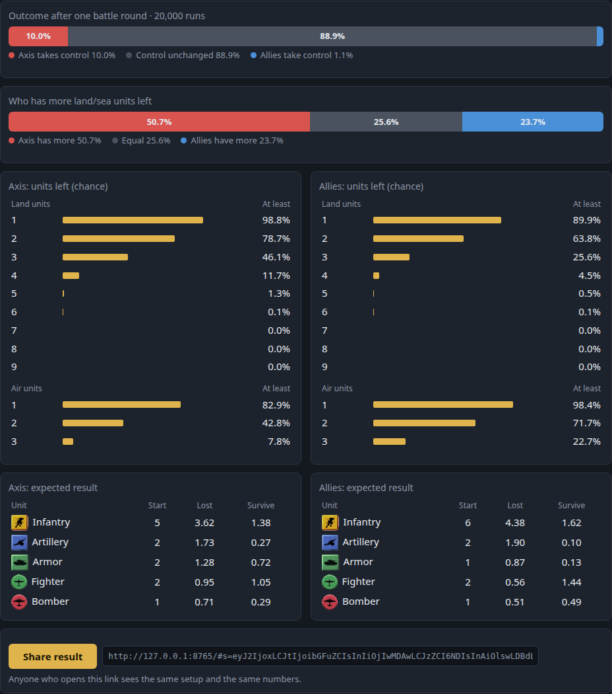
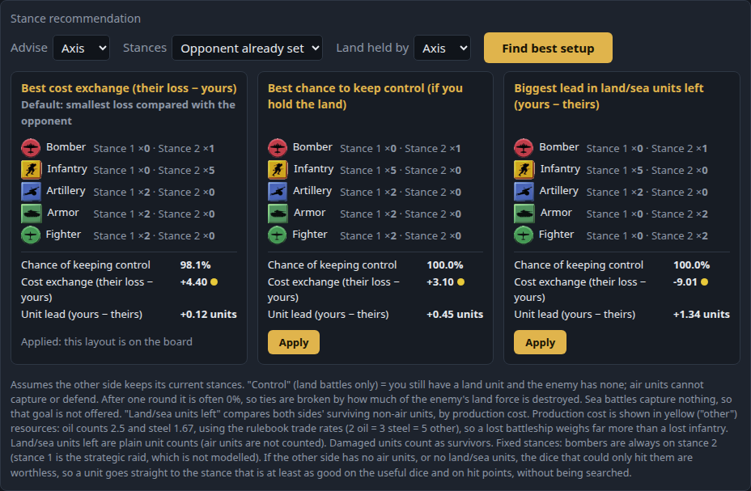
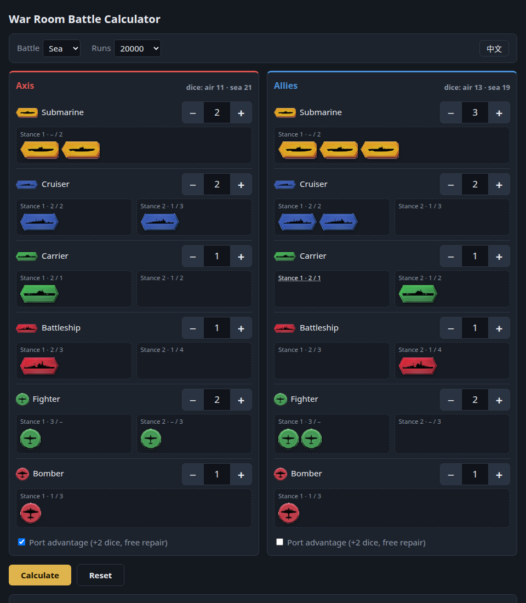

<div align="center">

# War Room Battle Calculator

**Plan your battle. Compare your stances. Know the odds.**

A browser-based companion for the **War Room** board game, with land and sea battle simulations, stance recommendations, and shareable setups.

 &nbsp;
 &nbsp;
 &nbsp;


**No dependencies · No build step · English / 中文**

**English** · [简体中文](README.zh-CN.md)

[**▶ Try the live calculator**](https://yuzhouboat.github.io/warroom-calc/)

[Feature tour](#feature-tour) · [Quick start](#quick-start) · [How to use](#how-to-use) · [Deploy](#deploy-with-github-pages)

</div>

---



## What you can do

| Feature | What it helps you explore |
| --- | --- |
| **Land & sea battles** | Set up Axis and Allied forces, including aircraft and naval units. |
| **Battle odds** | Run 5,000, 20,000, or 100,000 simulations to estimate outcomes, losses, and survivors. |
| **Interactive stances** | Drag unit tokens between stances, or select a token and then its destination. |
| **Stance recommendations** | Compare layouts for territory control, resource exchange, or surviving unit advantage. |
| **Opponent replies** | Search against a fixed enemy setup, or account for their best reply when you set first. |
| **Save & share** | Keep settings in your browser and share a battle setup with a link. |
| **Bilingual interface** | Switch between English and Chinese with the language button. |

All calculations run in your browser. No account, API key, database, or backend is required.

## Feature tour

### See the odds before you commit

Compare territory control, surviving forces, and expected losses in one view. The example below uses **20,000 simulated battle rounds**; the bars show how often each outcome occurred.



### Find a stance that fits your goal

Choose between resource exchange, keeping or taking territory, and surviving unit advantage. Each recommendation shows the suggested unit layout and its estimated results, with an **Apply** button to put it on the board.



### Take the battle to sea

Build a fleet with submarines, cruisers, carriers, and battleships, add air support, and account for port advantage.

<details>
<summary><strong>View the naval battle setup</strong></summary>



</details>

Screenshots show example forces and simulation estimates, rather than guaranteed battle outcomes.

## Quick start

You need **Git** to clone the repository and **Python 3** to run a local web server.

```sh
git clone https://github.com/Yuzhouboat/warroom-calc.git
cd warroom-calc
python3 -m http.server 8000 --bind 127.0.0.1
```

Open **[http://localhost:8000](http://localhost:8000)** in a modern browser. Leave the terminal running while you use the app; press `Ctrl+C` to stop the server.

On Windows, use `py -m http.server 8000 --bind 127.0.0.1` if `python3` is unavailable.

> Already have this repository on your computer? Open a terminal in its folder and run only the server command.

## How to use

1. Choose **Land** or **Sea** and a simulation run count. Start with the default **20,000** runs.
2. Add units to the **Axis** and **Allies** panels using the number fields or `+` / `−` buttons.
3. Move units into their desired stances and set port advantage for a sea battle when applicable.
4. Click **Calculate** to see outcome probabilities and expected losses and survivors.
5. To explore alternatives, choose the side to advise and click **Find best setup**. For land battles, also select who currently holds the territory.
6. Compare the recommendation cards and use **Apply** to inspect a layout. Use the share button beneath the results to copy a setup link.

Open **Rules applied by this calculator** inside the app for the detailed combat rules and assumptions.

## Deploy with GitHub Pages

GitHub Pages can serve this app directly from the repository. **There is no build command or package installation.**

1. Push the app files to the repository's **`main`** branch on GitHub. If you want your own copy, fork this repository first.
2. Open your repository on GitHub and go to **Settings → Pages**.
3. Under **Build and deployment**, set **Source** to **Deploy from a branch**.
4. Select **`main`** and **`/ (root)`**, then click **Save**.
5. Wait for the Pages deployment to finish. The **Actions** tab shows its progress, and **Settings → Pages** displays the published URL.

This repository is live at:

**[https://yuzhouboat.github.io/warroom-calc/](https://yuzhouboat.github.io/warroom-calc/)**

For a fork, replace `yuzhouboat` with your GitHub username and use your repository's name. Your address becomes available after Pages is enabled and the first deployment succeeds.

**Updating the site:** push changes to `main`; GitHub Pages republishes the site automatically.

GitHub Pages is available for public repositories on GitHub Free; private repository support depends on your plan. See [GitHub's publishing instructions](https://docs.github.com/en/pages/getting-started-with-github-pages/configuring-a-publishing-source-for-your-github-pages-site) for details.

### Other static hosts

You can also upload these files to any static web host, preserving their relative paths:

```text
index.html
engine.js
recommend.js
icons/
```

Serve `index.html` as the entry page. No environment variables or server-side runtime are needed.

### Deployment troubleshooting

| Symptom | What to check |
| --- | --- |
| The Pages URL returns 404 | Confirm Pages uses `main` and `/ (root)`, and check the deployment status in **Actions**. |
| Icons are missing or calculations do not work | Make sure both JavaScript files and the entire `icons/` folder were deployed alongside `index.html`. |
| The site still shows an older version | Wait for the deployment to finish, then refresh with your browser's cache bypass shortcut. |
| Local port 8000 is already in use | Run the server with `8001` instead and open `http://localhost:8001`. |

## Understanding the estimates

- Results are Monte Carlo estimates, so probabilities can vary between runs. More runs generally give steadier estimates.
- Damaged units count as survivors; repair costs are not included in loss estimates.
- Some rules and actions are outside the simulation. The app's built-in rules section lists these limits and explains targeting assumptions.
- Recommendation searches for larger forces use a heuristic and are not guaranteed to find the best possible layout.

## Project files

```text
warroom-calc/
├── index.html      # Interface, styling, translations, and browser state
├── engine.js       # Battle simulation engine (browser and Node.js)
├── recommend.js    # Stance recommendation search (browser and Node.js)
├── icons/          # Unit artwork
├── docs/screenshots/ # Feature screenshots used in this README
├── README.md       # English guide
└── README.zh-CN.md # Chinese guide
```

To change the interface or translations, edit `index.html`. Combat logic lives in `engine.js`, and recommendation logic lives in `recommend.js`. Refresh the browser after editing; no compilation is needed.
