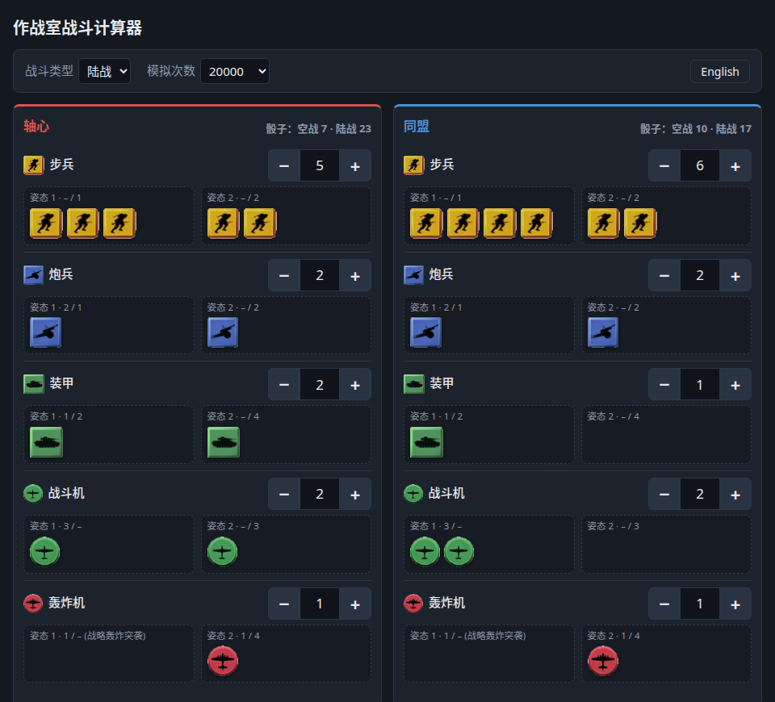
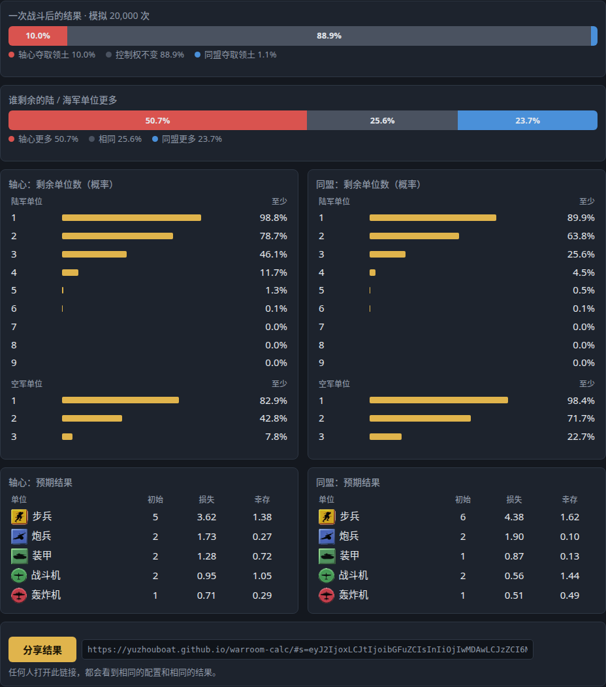
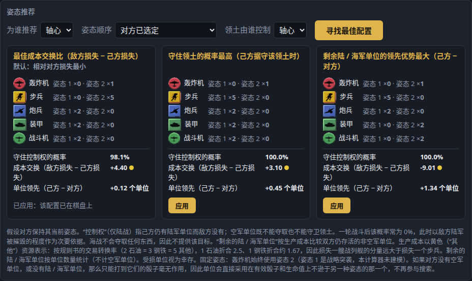
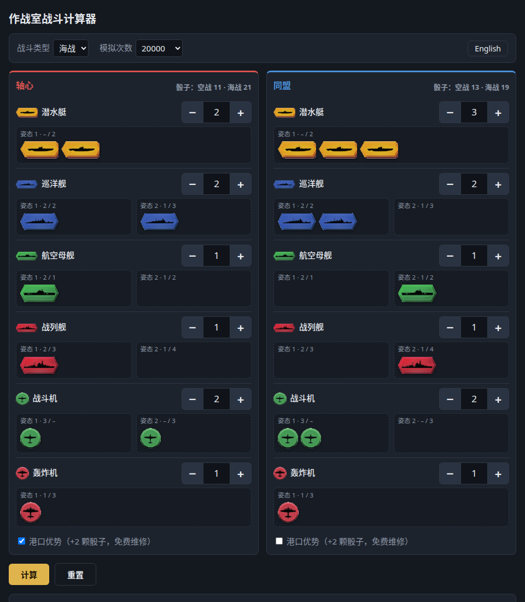

<div align="center">

# 作战室战斗计算器

**规划战斗，比较姿态，让决策更有把握。**

为 **War Room（作战室）** 桌游打造的浏览器工具，支持陆战与海战模拟、单位姿态推荐，以及战斗配置分享。

 &nbsp;
 &nbsp;
 &nbsp;


**陆战与海战 · 浏览器直接使用 · 支持中英文**

[English](README.md) · **简体中文**

[**▶ 在线体验计算器**](https://yuzhouboat.github.io/warroom-calc/)

[使用方法](#使用方法) · [功能预览](#功能预览) · [如何理解模拟结果](#如何理解模拟结果) · [技术说明](#技术说明)

</div>

---



## 主要功能

| 功能 | 可以做什么 |
| --- | --- |
| **陆战与海战** | 配置轴心与同盟双方的陆军、海军和空军。 |
| **战斗概率估算** | 进行 5,000、20,000 或 100,000 次模拟，估算战斗结果、损失与幸存单位。 |
| **交互式姿态调整** | 拖动单位标记切换姿态，或选中标记后点击目标姿态区域。 |
| **姿态推荐** | 按领土控制、资源交换或幸存单位数量优势，比较不同配置。 |
| **对手应对分析** | 针对对方已确定的配置搜索，或在己方先选时考虑对方的最佳应对。 |
| **保存与分享** | 在浏览器中保留设置，并通过链接分享战斗配置。 |
| **双语界面** | 点击语言按钮，在中文和英文之间切换。 |

打开在线计算器即可开始使用，无需注册账号或安装软件。

## 使用方法

[**打开计算器 →**](https://yuzhouboat.github.io/warroom-calc/)

1. 选择**陆战**或**海战**及模拟次数，建议先使用默认的 **20,000** 次。
2. 使用数字输入框或 `+` / `−` 按钮，为**轴心**与**同盟**添加单位。
3. 将单位移入所需姿态；进行海战时，按实际情况勾选港口优势。
4. 点击**计算**，查看结果概率、预期损失与幸存单位。
5. 需要比较方案时，选择要提供建议的一方，点击姿态推荐区域的搜索按钮。陆战还需选择当前领土归属。
6. 比较推荐卡片，点击**应用**查看对应配置。点击结果下方的分享按钮，可复制配置链接。

如果在线页面显示英文，点击页面顶部的 **中文** 按钮即可切换。详细战斗规则与模拟假设见页面内的**本计算器采用的规则**。

## 功能预览

### 开战前，先看清概率

在同一页面查看领土控制概率、幸存兵力和预期损失。下图展示了 **20,000 次单轮战斗模拟**的统计结果，条形图表示各结果出现的频率。



### 根据目标选择姿态

根据资源交换、守住或夺取领土、幸存单位数量优势选择方案。推荐卡片会列出单位配置与预估结果，点击**应用**即可把配置放到战斗面板上。



### 把战场转向海上

配置潜水艇、巡洋舰、航空母舰和战列舰，搭配空中支援，并按实际情况启用港口优势。

<details>
<summary><strong>展开查看海战配置</strong></summary>



</details>

截图中的兵力与结果仅为示例。模拟值用于估算，不代表实际战斗的必然结果。

## 如何理解模拟结果

- 结果来自蒙特卡洛模拟，每次运行的概率可能略有差异。增加模拟次数通常能让估算更稳定。
- 受损但未被摧毁的单位计为幸存，损失估算不包含维修成本。
- 模拟未覆盖所有规则和行动。页面内的规则说明列出了限制，并解释了目标分配等假设。
- 大规模兵力的姿态搜索采用启发式算法，不保证找到全局最优配置。

---

## 技术说明

<details>
<summary><strong>本地运行、部署、故障排查与源码说明（点击展开）</strong></summary>

### 本地运行

需要 **Git** 来克隆仓库，以及 **Python 3** 来启动本地静态服务器。

```sh
git clone https://github.com/Yuzhouboat/warroom-calc.git
cd warroom-calc
python3 -m http.server 8000 --bind 127.0.0.1
```

在现代浏览器中打开 **[http://localhost:8000](http://localhost:8000)**。使用时保持终端运行，结束后按 `Ctrl+C` 停止服务器。

Windows 用户如果无法使用 `python3`，可以改用：

```sh
py -m http.server 8000 --bind 127.0.0.1
```

> 已经下载了仓库？在项目文件夹内打开终端，只运行启动服务器的命令即可。

### 部署到 GitHub Pages

GitHub Pages 可以直接托管本项目，**不需要构建命令，也不需要安装依赖**。

1. 将项目文件推送到 GitHub 仓库的 **`main`** 分支。需要独立部署自己的版本时，先 Fork 本仓库。
2. 打开仓库的 **Settings → Pages**。
3. 在 **Build and deployment** 下，将 **Source** 设置为 **Deploy from a branch**。
4. 选择 **`main`** 分支和 **`/ (root)`** 目录，点击 **Save**。
5. 等待部署完成。可以在 **Actions** 查看进度，在 **Settings → Pages** 查看发布地址。

本仓库的在线地址：

**[https://yuzhouboat.github.io/warroom-calc/](https://yuzhouboat.github.io/warroom-calc/)**

如果使用 Fork 仓库，将地址中的 `yuzhouboat` 换成你的 GitHub 用户名，并使用自己的仓库名称。启用 Pages 且首次部署成功后，地址才可访问。

**后续更新：** 将修改推送到 `main`，GitHub Pages 会自动重新发布。

GitHub Free 支持为公开仓库启用 Pages；私有仓库是否支持取决于账号套餐。详见 [GitHub 官方发布指南](https://docs.github.com/en/pages/getting-started-with-github-pages/configuring-a-publishing-source-for-your-github-pages-site)。

#### 部署到其他静态托管服务

也可以将以下文件上传至任意静态网站托管服务，保持相对路径不变：

```text
index.html
engine.js
recommend.js
icons/
```

将 `index.html` 作为网站入口即可，无需环境变量或服务端运行环境。

#### 常见问题

| 问题 | 检查方法 |
| --- | --- |
| Pages 地址返回 404 | 确认发布源为 `main` 和 `/ (root)`，并在 **Actions** 查看部署状态。 |
| 图标缺失或无法计算 | 确认两个 JavaScript 文件与完整的 `icons/` 目录和 `index.html` 一起上传。 |
| 页面仍是旧版本 | 等待部署完成，再使用浏览器的强制刷新功能绕过缓存。 |
| 本地 8000 端口被占用 | 将服务器命令中的端口改为 `8001`，然后访问 `http://localhost:8001`。 |

### 项目结构

```text
warroom-calc/
├── index.html         # 界面、样式、翻译及浏览器状态
├── engine.js          # 战斗模拟引擎，支持浏览器和 Node.js
├── recommend.js       # 姿态推荐搜索，支持浏览器和 Node.js
├── icons/             # 单位图片
├── docs/screenshots/  # README 功能截图
├── README.md          # 英文说明
└── README.zh-CN.md    # 中文说明
```

修改界面或翻译请编辑 `index.html`；战斗逻辑在 `engine.js` 中，推荐逻辑在 `recommend.js` 中。编辑后刷新浏览器即可，无需编译。

</details>
